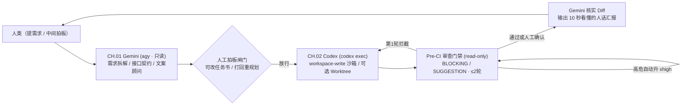

<p align="left">
  
</p>

# TENON（榫）— 本地多 Agent 与多协议 API 协同工作台

> **Many models. One exact joint.** — 零第三方 npm 依赖的本地多模型协同与无限节点画布工坊。原生协同 **Gemini (`agy`)**、**Codex (`codex`)**、**Claude Code (`claude`)**、**Ollama / LM Studio** 及 **OpenAI / Anthropic / Gemini REST 流式 API**，通过人工拍板闸门与 Pre-CI 分级门禁让多模型如榫卯般严密咬合交付。

---

## 核心特性

* **零第三方 npm 依赖，秒级冷启动**：纯 Node.js 原生 HTTP + SSE 实时流式推送，开箱即用。
* **100% 合规官方 CLI 封装**：只调用本机官方 `agy --print --output-format stream-json` 与 `codex exec --json`，不触碰私有接口，绝不开放无沙箱全权限模式（强制 `workspace-write` / `read-only`）。
* **五种实战协同模式**：
  1. **全链路协同**：`01 Gemini 只读规划` → `02 人工拍板闸门（可在线修改指令或打回重来）` → `03 Codex 沙箱施工` → `04 Pre-CI 分级审查（最多 2 轮，高危文件自动升 xhigh）` → `05 Gemini 人话交付汇报`
  2. **独立规划**：仅用 Gemini 输出接口契约与验收清单
  3. **Codex 直派**：指定接口契约直接下发 Codex 施工，支持 Git Worktree 隔离与 `--resume` 会话续跑
  4. **审查门禁**：针对工作区 Git 变更运行两级审查（`BLOCKING` vs `SUGGESTION`），命中 auth / payment / permission / deploy 等路径自动升档 `xhigh`
  5. **文案顾问**：请 Gemini 4 Neon 去除界面文案与交互说明中的 AI 解释腔
* **附带三套独立 CLI 脚本 & 规则模板**：即使不开网页，也可以在终端或 Antigravity 中直接调用 `gemini-ask.mjs`、`codex-worker.mjs`、`codex-review.mjs`，并内置 `templates/GEMINI.md` 与 `templates/CODEX.md`。
* **Codex 桌面端聊天流式界面 + 三节点交互画布 + ThinkingOrbs + 连续曲率圆角体系**：以 Awwwards SOTD 7.37 标杆 **DeepBook** 为视觉基调，全站统一采用**连续曲率圆角（Squircle 阶梯：`10px / 18px / 24px / 999px`）** 与胶囊按键几何呼应，原生融合：
  * **全局自定义黑曜石模型选择器**：彻底替换原生操作系统 `<select>`，提供分组展示（`Gemini 4 Neon / Series / Orchestrator / 3.8 Flash`）、实时搜索、内联刷新与 Codex 自定义模型输入；
  * **3D Fibonacci `ThinkingOrbs` 活体点球状态引擎（`public/thinking-orbs.js`）**：根据真实阶段自动切换 `reasoning-twins`（规划思考）、`working-gyro`（沙箱施工）、`searching-lighthouse`（Pre-CI 扫描）、`waiting`（等待拍板）与 `compacting-fuse`（汇报汇总），零依赖纯 SVG 矢量渲染；
  * **Blender 风格全屏无限 Agent 集群画布（`public/node-canvas.js`，顶栏一键切至 `节点画布`）**：支持**空白区无限拖拽平移、鼠标指针中心滚轮缩放（`25%–200%`）、自由拖拽任意节点卡片（按住 `Shift` 吸附网格）、端口拖拽实时拉线连结（内置 DAG 防环检测与悬停断线）、Blender 风格右键上下文菜单与 `Shift+A` 快捷新建（含 `Shift+D` 复制、`M` 静音跳过、`L` 自动拓扑整理、空白画布与自定义模板持久化）、每个节点卡片内直接切换专属模型与推理深度、卡片内嵌树状思考工作流（`Chain of Thought #28391`）、画布底部集群任务指令栏以及运行后自动滑出的右侧「集群总汇报 / 当前节点详情」成果与追问抽屉**；内置 `5 节点集群`、`9 节点双集群二级合并`、`3 节点精简` 与 `空白自定义` 预设；
  * **左下角 21st.dev 5 模式声学遥测音波台（`Audio Visualizer #44800`）**：支持 `BAR`（频谱柱）/ `GRD`（LED 矩阵）/ `WAV`（双轨示波）/ `DOT`（能量珠串）/ `RAD`（环形频谱）一键切换、鼠标悬停声学波纹感应，并与真实引擎/集群状态实时联动；
  * **FLIP 分支思路卡组（`Branching Reasoning Deck`）**：Gemini 规划阶段动态扇形展开 3 条架构路线并评分，完成后丝滑收拢为采纳路线卡片，可随时点击展开切换备选思路；
  * **Ink-Orbit 动态三联 SVG 架构图 & Liquid Metal（`metal-fx` WebGL2 边环）& `ai-thinking-and-tool-calls` SVG 树状思考轨**：以及 `Chat Sidebar`、`Conversation`、`Rich Prompt Input`（`/` + `@`）、`Diff Viewer`（Unified/Split）、`Border Beam`、`Segmented Tabs` 与右下角可完全收起的 **Tweaks 调参台**（快捷键 `T`）。

---

## 协同架构



---

## 快速启动

### 前置依赖
* Node.js `>= 18`（已验证 `v24.14.0`）
* 本机已安装并登录 [Antigravity CLI (`agy`)](https://antigravity.google/) 与 OpenAI `codex` CLI
* Git（用于查看实时 Diff、风险路径检测与可选 Worktree 隔离）

### 启动可视化工作台
* **Windows 安装版（推荐）**：直接运行 [Releases](https://github.com/jiuyang5354/tenon-workbench/releases) 中的 `TENON-Setup-1.0.0.exe` 安装到本机（含桌面/开始菜单图标与设置内一键检测更新）；或运行 `npm run build:win` 本地重新打包。
* **Windows 免安装脚本**：双击 `启动工作台.bat` 或运行 `.\start.ps1`
* **命令行启动（零依赖 Web 模式）**：
  ```bash
  node server.mjs
  # 浏览器访问 http://127.0.0.1:4177
  ```

### 运行内置测试
```bash
node --test tests/orchestrator.test.mjs
```

---

## 独立 CLI 脚本用法

```bash
# 1. Gemini 只读独立规划
node scripts/gemini-ask.mjs --dir "D:\your-project" --model gemini-4-neon-high --mode plan "设计订单幂等重试模块"

# 2. Gemini 界面文案与交互润色
node scripts/gemini-ask.mjs --model gemini-4-neon-high --copy "选中对话里的一段话，点侧边问就能在这顺便问一句"

# 3. Codex 安全沙箱施工（支持 --worktree 隔离与 --resume 续跑）
node scripts/codex-worker.mjs --dir "D:\your-project" --effort high "按接口契约实现模块并补全单元测试"

# 4. Pre-CI 代码审查门禁（退出码 0=通过 / 2=检出 BLOCKING 拦截 / 1=执行异常）
node scripts/codex-review.mjs --dir "D:\your-project"
```

---

## 目录结构

```text
├── server.mjs               # Node HTTP + SSE 服务入口
├── start.ps1 / 启动工作台.bat # Windows 一键启动器
├── lib/
│   ├── cli-detect.mjs       # 本机 agy / codex / git 探测与 config.toml 只读解析
│   ├── runners.mjs          # agy stream-json & codex exec --json 子进程流式执行器
│   ├── orchestrator.mjs     # 五模式调度状态机、人工拍板闸门与分级审查循环
│   ├── workspace.mjs        # Git 探测、Diff 提取与高危路径自动升档判断
│   └── store.mjs            # 本地台账持久化 (data/runs.json, 已 gitignore) 与 SSE 广播
├── scripts/                 # 可脱离网页独立调用的三大 CLI 封装脚本
├── templates/               # 可直接复用的 GEMINI.md 与 CODEX.md 双模型规则模板
├── public/                  # DeepBook 精密工程风前端与 Tweaks 实时调参台
└── tests/                   # 零依赖 node:test 单元与接口集成测试
```

---

## 安全与隐私说明

* 所有任务历史仅保存在本地 `data/runs.json`（已在 `.gitignore` 忽略），不会上传到任何第三方服务端。
* 所有状态修改类 `POST` 接口均强制校验本地 `Origin`、`Sec-Fetch-Site` 与 `Content-Type: application/json`，防止浏览器跨站 CSRF 触发本地命令行执行。
* `lib/cli-detect.mjs` 仅读取 `config.toml` 中的非敏感字段（默认模型、provider 名称与推理深度），**绝不读取或暴露 `auth.json`、API Key 或任何凭据**。
* `codex-worker` 强制限定沙箱为 `workspace-write` 或 `read-only`（含 `--resume` 续跑），禁用 `--dangerously-bypass-approvals-and-sandbox`；开启 Worktree 时使用受管隔离目录，确保施工、Diff 与审查全部命中同一隔离工作树。
